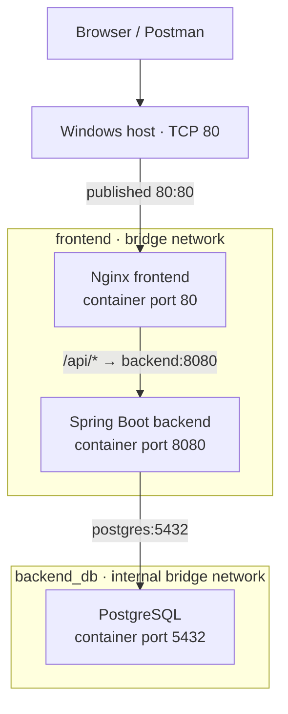

# TITAN Container Network Architecture

## Purpose

TITAN uses two user-defined Docker bridge networks to keep the database off the frontend network while preserving the required application paths.

## Logical network diagram



The backend is the only service attached to both networks. It provides the required connection between the frontend tier and the database tier.

## Network and service membership

| Compose network | Driver | Internal | Attached services |
|---|---|---:|---|
| `frontend` | bridge | false | `frontend`, `backend` |
| `backend_db` | bridge | true | `backend`, `postgres` |

Docker inspection during the M2-05 implementation confirmed:
- `titan-commerce_frontend`: Nginx frontend and Spring Boot backend.
- `titan-commerce_backend_db`: Spring Boot backend and PostgreSQL.
- PostgreSQL is not attached to the frontend network.
- The backend is attached to both networks.

Observed local subnets at validation time were `172.20.0.0/16` for `frontend` and `172.19.0.0/16` for `backend_db`. These are Docker-assigned local values, not static addresses or deployment requirements. Services must use Compose DNS names, not container IP addresses.

## Port publishing and service discovery

| Service | Container port | Host-published port | Reachability |
|---|---:|---:|---|
| Nginx frontend | 80 | `80:80` | Host/browser/Postman can reach it at `http://localhost` |
| Spring Boot backend | 8080 | None | Internal Compose network only |
| PostgreSQL | 5432 | None | Internal `backend_db` network only |

The backend's Compose `expose: ["8080"]` documents its container port for internal service communication; it does not publish that port on the host. PostgreSQL has no `ports` mapping. Do not add host port mappings for the backend or database without a concrete operational requirement and security review.

Compose DNS provides stable service-name discovery on shared networks:
- Nginx proxies `/api/` requests to `http://backend:8080/api/`.
- The backend connects to PostgreSQL at `postgres:5432`.

The subnet and container IP addresses can change when Docker recreates the networks or containers. Use service names in application configuration.

## Verified communication paths

The following checks were performed during M2-05:

1. **Client to storefront/API path:** Postman sent `GET http://localhost/api/products` and received `200 OK` with product JSON. Nginx configuration proxies `/api/` to `backend:8080`; the backend uses the PostgreSQL service hostname.
2. **Backend health:** the actuator endpoint called from the frontend container at `http://backend:8080/actuator/health` returned `status: UP`.
3. **Database readiness:** `docker compose exec postgres pg_isready -U titan_user -d titan_commerce` returned `accepting connections`.
4. **Frontend isolation from PostgreSQL:** from the Nginx container, `wget -T 3 -O - http://postgres:5432` returned `wget: bad address 'postgres:5432'`. The frontend cannot resolve the PostgreSQL service name because it is not attached to a network shared with PostgreSQL. This is the expected negative test.
5. **Host port boundary:** Compose publishes only the frontend's `80:80` mapping. Backend 8080 and PostgreSQL 5432 are not published to the host.

The negative test validates Docker DNS isolation for the frontend-to-database path. It is not a general test of every possible network policy or host-level access path.

## Diagnosing a network-path failure

Use the following order to narrow down a failed request:

1. Check service state with `docker compose ps`.
2. Check the affected service logs, for example `docker compose logs --tail 100 --no-color frontend`.
3. Inspect network membership with `docker network inspect titan-commerce_frontend` and `docker network inspect titan-commerce_backend_db`.
4. Test service-name resolution and the expected service port from a container attached to the appropriate network. For example, use the frontend container to request the backend health endpoint.
5. Check the backend-to-database path with `docker compose exec postgres pg_isready -U titan_user -d titan_commerce` and review backend connection logs.

Interpretation:
- A DNS error such as `bad address 'postgres'` from the frontend is expected isolation, not a service outage.
- A DNS error for `backend` from the frontend indicates a likely network attachment or service-name issue.
- A backend database connection failure requires checking PostgreSQL health, backend logs, and the backend's `backend_db` network attachment.
- A host connection failure to `localhost` should start with frontend container state and the published port mapping.

## Security and operational boundaries

- Keep PostgreSQL on `backend_db` only.
- Keep the backend attached to both networks because it must receive proxied requests and access PostgreSQL.
- Keep the host-published port limited to Nginx unless a reviewed requirement changes the design.
- The `backend_db` network is marked `internal: true`, preventing that network from providing external connectivity. PostgreSQL does not need outbound internet access for the current local application flow.
- The `frontend` network is a normal bridge network; Nginx and the backend can use it for the application path.
- Network isolation reduces unnecessary reachability; it does not replace authentication, application authorization, secret management, or host firewall controls.

## Applying network changes

After editing Compose networking configuration, validate the rendered configuration before applying it:

```powershell
docker compose config -q
docker compose up -d
```

The `up -d` operation creates/reconciles the networks and recreates services as required by the changed configuration. It does not require rebuilding images when only network definitions change. The external PostgreSQL volume remains external; never use `docker compose down -v` as a routine network troubleshooting step.

## Known scope

This is the local Docker Compose network design for TITAN. It does not implement AWS VPCs, cloud firewalls, Kubernetes network policies, or a production multi-host network. Those belong to later deployment milestones.
