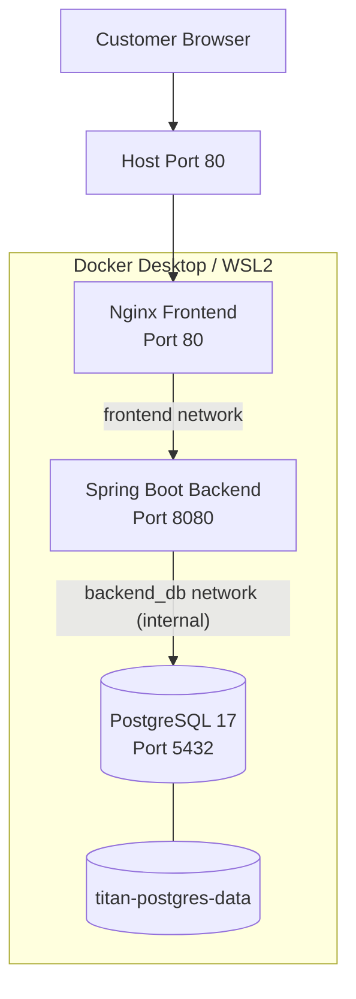

# TITAN Commerce — Docker Runtime Architecture

- **Document Version:** 1.0
- **Milestone:** M2 — Docker Engineering
- **Related Issue:** #23
- **Status:** Runtime investigation completed
- **Environment:** Windows 11 + Docker Desktop + WSL2

---

## 1. Overview

This document describes the actual Docker runtime architecture
used to operate TITAN Commerce locally.

TITAN Commerce consists of three containerized services:

- React frontend served through Nginx
- Spring Boot backend API
- PostgreSQL database

Docker Compose manages the application containers, their network
connectivity, service dependencies and persistent database storage.

The environment runs on Windows 11 using Docker Desktop and WSL2.

This document records observed runtime configuration rather
than assuming an idealized deployment architecture.

## 2. Docker Environment

### 2.1 Host and Engine

| Component | Observed Configuration |
|---|---|
| Host OS | Windows 11 |
| Container environment | Linux |
| Docker Desktop | 4.98.0 |
| Docker CLI | 29.9.2 |
| Docker Engine | 29.9.2 |
| Docker API | 1.56 |
| Architecture | AMD64 / x86_64 |
| Linux Kernel | 6.18.54.1-microsoft-standard-WSL2 |
| Active Docker Context | desktop-linux |

### 2.2 Runtime Components

| Component | Version |
|---|---|
| containerd | 2.4.2 |
| runc | 1.5.2 |
| docker-init | 0.19.0 |

Default runtime: `runc`

The Docker CLI executes on Windows and communicates with the
Docker Engine operating in Docker Desktop's Linux environment.

Docker Engine coordinates container operations through its
runtime components.

Simplified execution flow:

Docker CLI
    |
    v
Docker Engine API
    |
    v
Docker Daemon (dockerd)
    |
    v
containerd
    |
    v
runc
    |
    v
Container Process

This represents the logical runtime flow, not every internal
implementation detail.

### 2.3 Docker Engine Configuration

| Property | Observed Value |
|---|---|
| Operating System | Docker Desktop |
| Storage Driver | overlayfs |
| Storage Driver Type | io.containerd.snapshotter.v1 |
| Logging Driver | local |
| Cgroup Driver | cgroupfs |
| Cgroup Version | 2 |
| Docker Runtimes | runc, io.containerd.runc.v2, nvidia |
| Default Runtime | runc |
| Security Options | seccomp, cgroupns |
| Live Restore | Disabled |
| Firewall Backend | iptables |
| Swarm | Inactive |
| CPUs Available | 8 |
| Total Docker Memory | 7.625 GiB |
| Docker Root Directory | /var/lib/docker |

Docker Desktop provides the Linux kernel environment through
WSL2 integration.

The Docker environment has access to 8 CPUs and approximately
7.625 GiB of memory.

These values describe the Docker environment's available
resources, not individual container resource limits.

## 3. TITAN Container Architecture

### 3.1 Application Services

The active Docker Compose project is:

`titan-commerce`

The Compose configuration is located at:

`docker-compose.yml`

The observed services are:

| Service | Container | Image | Internal Port |
|---|---|---|---|
| Frontend | titan-commerce-frontend-1 | titan-commerce-frontend | 80 |
| Backend | titan-commerce-backend-1 | titan-commerce-backend | 8080 |
| PostgreSQL | titan-commerce-postgres-1 | postgres:17 | 5432 |

All three containers carry Docker Compose labels identifying:

- Project: titan-commerce
- Working directory: TITAN repository
- Configuration file: docker-compose.yml

### 3.2 Application Communication and Network Segmentation

The application uses two Docker Compose networks to separate frontend traffic from database communication.

| Network | Connected Services | Configuration |
|---|---|---|
| `frontend` | Frontend, Backend | Bridge network |
| `backend_db` | Backend, PostgreSQL | Internal bridge network |

The expected request flow is:

1. Customer accesses the application through the host's published HTTP port `80`.
2. Nginx serves the React frontend.
3. Nginx forwards API requests to the backend using the Compose service name `backend` on port `8080`.
4. The backend connects to PostgreSQL using `postgres:5432` over the internal `backend_db` network.
5. PostgreSQL returns database results to the backend.

Network and exposure details:

- Frontend publishes host port `80`.
- Backend exposes port `8080` to other containers but does not publish it directly to the host.
- PostgreSQL listens on port `5432` within the Docker network and is not published to the host.
- The backend connects to both networks, allowing it to communicate with the frontend and PostgreSQL.
- The `backend_db` network is configured as internal, isolating database traffic from external network connectivity.

### 3.3 Architecture Diagram

The backend is connected to both Docker networks. The frontend communicates with the backend through the `frontend` network, while database communication remains isolated through the internal `backend_db` network.

### 3.4 Health Checks and Startup Dependencies

Docker Compose uses health checks to determine whether PostgreSQL and the backend are ready to accept requests.

| Service | Health Check | Interval | Timeout | Retries |
|---|---|---:|---:|---:|
| PostgreSQL | `pg_isready` | 10s | 5s | 5 |
| Backend | Spring Boot Actuator `/actuator/health` | 15s | 5s | 3 |
| Frontend | No independent health check configured | — | — | — |

The backend depends on PostgreSQL with:

`condition: service_healthy`

The frontend depends on the backend with:

`condition: service_healthy`

This ensures that dependent services wait for the configured health checks to succeed during startup.

These dependency conditions do not provide continuous dependency monitoring or automatic recovery after startup.