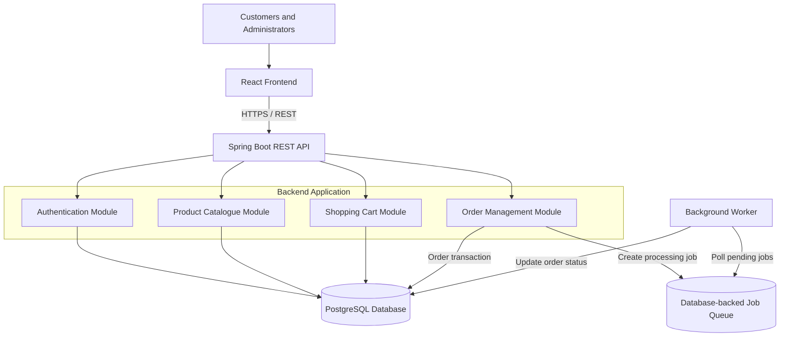

# TITAN Commerce — Initial System Architecture

**Document Version:** 1.0  
**Project:** Project TITAN  
**Status:** Initial Architecture Baseline

## 1. Overview

TITAN Commerce is a B2C e-commerce application built using React, Java Spring Boot and PostgreSQL.

The initial architecture follows a modular monolith approach with a separately runnable background worker.

The architecture prioritizes maintainability, reliability, security and cost-conscious development.

## 2. Architecture Diagram



## 3. Component Responsibilities

### 3.1 React Frontend

Responsibilities:
- Customer registration and login interfaces
- Product browsing
- Shopping cart management
- Order placement and order history
- Administrative interfaces

Communication:
- Uses REST APIs exposed by the Spring Boot backend.

### 3.2 Spring Boot Backend

Responsibilities:
- Authentication and authorization
- Product catalogue management
- Shopping cart operations
- Order creation and validation
- Business rule enforcement
- Database transactions
- Background job creation

The backend is organized into logical modules rather than separate microservices.

### 3.3 PostgreSQL

Responsibilities:
- Store customer accounts
- Store product catalogue information
- Store shopping carts
- Store orders and order statuses
- Store background processing jobs

PostgreSQL provides relational constraints and transaction support.

### 3.4 Background Worker

Responsibilities:
- Retrieve pending jobs
- Process orders asynchronously
- Handle processing failures
- Retry eligible failed jobs
- Prevent duplicate processing through idempotency
- Update job and order statuses

The worker runs independently from the API process while sharing the backend codebase.

## 4. Main Order Processing Flow

1. Customer submits an order through the React frontend.
2. The frontend sends an API request to Spring Boot.
3. The backend validates the request and business rules.
4. The backend creates the order and a corresponding background job within a database transaction.
5. The worker retrieves the pending job.
6. The worker processes the order.
7. The worker updates the order and job status.
8. The frontend retrieves the latest order status through the API.

## 5. Reliability Considerations

The initial architecture must account for:

- Transactional order and job creation
- Idempotent job processing
- Controlled retry mechanisms
- Failed job visibility
- Structured application logging
- Health checks for API and worker
- Database availability and connection failures

## 6. Security Considerations

- Authentication is required for customer accounts.
- Administrative operations require authorization.
- Passwords must never be stored in plaintext.
- Database credentials must not be committed to Git.
- Sensitive configuration must be supplied securely.
- API inputs must be validated.
- Production communication must use HTTPS.

## 7. Deployment Direction

Initial development:
- React frontend
- Spring Boot API
- PostgreSQL
- Background worker
- Docker and Docker Compose

Future engineering milestones will introduce:
- Container image optimization
- CI/CD automation
- Terraform infrastructure provisioning
- Kubernetes deployment
- GitOps
- Observability and security scanning
- Optional RabbitMQ integration

## 8. Architecture Boundaries

The initial version deliberately avoids:
- Premature microservices
- Real payment processing
- External courier integrations
- Unnecessary managed cloud dependencies

Future architecture changes must be evaluated and documented through Architecture Decision Records (ADRs).

## 9. Status

This document represents the initial architecture baseline. It may evolve as implementation, testing and operational requirements reveal new design considerations.
```

## Step 4 — Commit

At the bottom of the GitHub editor:

**Commit message:**

```text
docs: add initial TITAN system architecture
```

Select **Commit directly to the main branch**, then click **Commit changes**.

## Step 5 — Verify and close Issue #3

After committing:

1. Open `docs/architecture/initial-architecture.md`.
2. Verify the Mermaid diagram renders correctly.
3. Return to Issue #3.
4. Complete its acceptance criteria.
5. Add a comment:

```text
Initial system architecture documented in
docs/architecture/initial-architecture.md.

The architecture defines the React frontend, Spring Boot modular backend,
PostgreSQL database and independently runnable background worker.
```

6. Close the issue.
7. Move it to **Done** on your Project board.

---

## M0 progress

| Issue | Task | Status |
|---|---|---|
| #1 | Business requirements | Completed |
| #2 | Technology stack | Completed |
| #3 | Initial architecture | In progress |
| #4 | Architecture Decision Records | Pending |
| #5 | Contribution guidelines | Pending |

**Our next task after this:** Issue #4 — Architecture Decision Records (ADRs). We'll document the reasoning behind our major engineering decisions, including why we chose a modular monolith instead of microservices.

Let's get Issue #3 committed! 🚀
